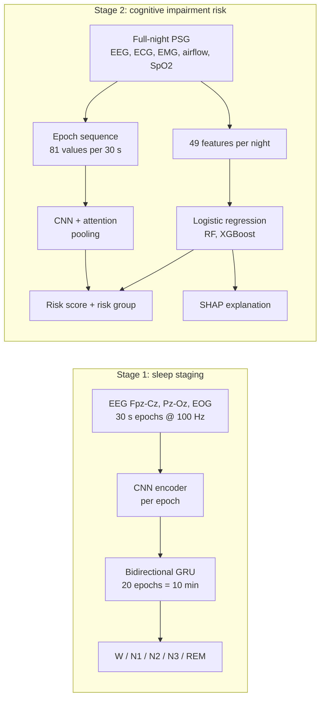
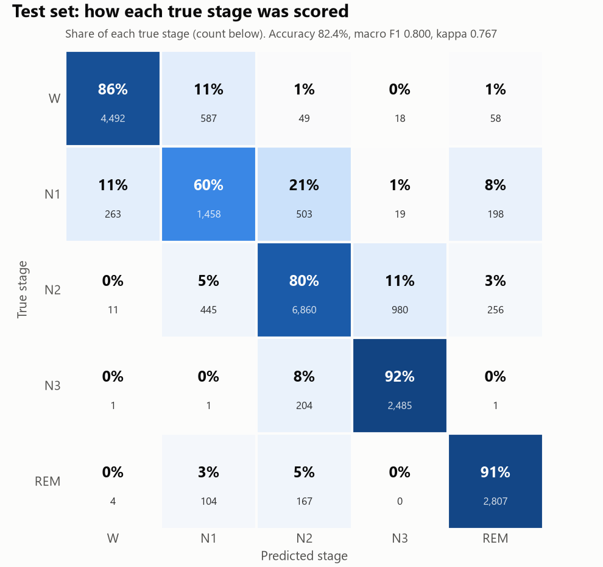

<div align="center">

# Sleep → Cognition

**AI-based prediction of cognitive impairment from one night of polysomnography**


[](LICENSE)

*Final-year engineering project*

</div>

---

Can an AI read one night's sleep recording and tell who is more likely to develop cognitive
impairment later, **beyond what age alone tells us**?

This project answers in two stages:

| | Stage | What it does | Data |
|---|---|---|---|
| **1** | **Sleep staging** | A neural network, trained from scratch, labels every 30 s of an overnight recording as W, N1, N2, N3 or REM | [Sleep-EDF Expanded](https://physionet.org/content/sleep-edfx/1.0.0/) |
| **2** | **Cognitive impairment risk** | 49 measurements per night (sleep structure, EEG, heart, breathing, oxygen, muscle tone) feed models that predict later impairment, explained with SHAP | [PhysioNet Challenge 2026](https://moody-challenge.physionet.org/2026/) (Human Sleep Project) |

## Contents

- [Highlights](#highlights)
- [How it works](#how-it-works)
- [Results](#results)
- [Datasets](#datasets)
- [Getting started](#getting-started)
- [Usage](#usage)
- [Project structure](#project-structure)
- [Limitations](#limitations)
- [Acknowledgements](#acknowledgements)
- [Citation](#citation)
- [License](#license)

## Highlights

- **82.4% sleep-stage accuracy** (Cohen's κ 0.767) on 20 recordings the network never saw.
- **Beats age alone** at predicting later cognitive impairment: age-conditioned AUROC **0.672** vs **0.528**, across **6,429 people** from **3 hospitals**.
- **Deep learning on the whole night:** a CNN with attention pooling reaches **0.694**, and averaging it with the logistic regression gives **0.704**.
- **Tested on unseen hospitals:** each hospital is held out of training in turn and used as the test set.
- **Explainable:** SHAP shows which sleep signals raise or lower each person's risk.
- **Scales to 1.2 TB:** feature extraction streams one night at a time, in parallel, with checkpoints.

## How it works



**Stage 1.** A 1-D CNN turns each 30-second epoch (3 channels) into a feature vector. A
bidirectional GRU then reads 20 consecutive epochs, so each prediction sees the 10 minutes
around it, the way a human scorer uses context.

**Stage 2.** Each night becomes 49 measurements: stage fractions and timing, EEG band power per
stage (including sleep-spindle sigma power), heart rate and variability, breathing, oxygen
saturation, limb movements and chin muscle tone. Models are compared against an **age-only**
baseline, because age alone already predicts impairment.

## Results

### Stage 1: sleep staging

| Metric (20 held-out recordings) | Score |
|---|---|
| Accuracy | **82.4%** |
| Macro F1 | **0.800** |
| Cohen's κ | **0.767** |

| Stage | W | N1 | N2 | N3 | REM |
|---|---|---|---|---|---|
| F1 | 0.901 | 0.579 | 0.840 | 0.802 | 0.877 |

<p align="center">
  
  
</p>

### Stage 2: cognitive impairment

6,429 people, 487 later impaired (7.6%), after dropping 93 nights with under two hours of
scored sleep. Flat EEG channels count as missing, and the linear model caps every feature at
its 1st and 99th percentile so a few broken recordings cannot dominate it.

| Age-conditioned AUROC | Age only | Logistic regression |
|---|---|---|
| 5-fold cross-validation × 10 | 0.528 | **0.672** |
| Held-out hospital I0002 (307 people) | 0.518 | **0.781** |
| Held-out hospital I0006 (1,122 people) | 0.535 | **0.663** |
| Held-out hospital S0001 (5,000 people) | 0.537 | **0.572** |

> **Why age-conditioned?** It only compares people within 2 years of age of each other, so it
> measures what sleep adds beyond age. 0.5 = guessing. Random forest and XGBoost were also
> tested; logistic regression was the most robust. Full numbers are in
> [`results/cognitive/hsp_large_baseline_report.txt`](results/cognitive/hsp_large_baseline_report.txt).

<p align="center">
  
</p>

### Stage 2: deep learning on the whole night

A 1-D CNN reads each night as a sequence of up to 1,200 epochs (81 numbers per 30-second epoch:
EEG spectrum, heart rate, SpO2, breathing, chin tone and sleep stage). Attention pooling learns
which parts of the night matter, and the ensemble averages its risk with the logistic
regression's. Trained on a Kaggle T4 GPU; 3 networks averaged per split.

| Age-conditioned AUROC | Deep network | Logistic regression | Ensemble |
|---|---|---|---|
| 5-fold cross-validation (one repeat) | 0.694 | 0.677 | **0.704** |
| Held-out hospital I0002 | 0.692 | **0.781** | 0.774 |
| Held-out hospital I0006 | **0.702** | 0.663 | 0.699 |
| Held-out hospital S0001 | 0.576 | 0.572 | **0.582** |

The ensemble is the most consistent model: best or close to best at every hospital. Full
numbers are in [`results/cognitive/hsp_large_deep_report.txt`](results/cognitive/hsp_large_deep_report.txt).

The strongest sleep signals are **reduced sleep-spindle (sigma) power**, **more limb
movements**, **more light N2 sleep** and **less REM sleep**.

## Datasets

| Dataset | Used for | Contents | Access |
|---|---|---|---|
| [Sleep-EDF Database Expanded 1.0.0](https://physionet.org/content/sleep-edfx/1.0.0/) | Stage 1 | 197 overnight recordings from 100 people (Sleep Cassette, age 25–101, and Sleep Telemetry). EEG Fpz-Cz, EEG Pz-Oz and EOG at 100 Hz with expert hypnograms. 8.1 GB, open access | [Direct zip](https://physionet.org/static/published-projects/sleep-edfx/sleep-edf-database-expanded-1.0.0.zip) → unzip to `Dataset/archive/sleep-edf-database-expanded-1.0.0/` |
| [PhysioNet Challenge 2026](https://moody-challenge.physionet.org/2026/) (Human Sleep Project) | Stage 2 | Clinical PSG (EEG, EOG, chin and leg EMG, ECG, airflow, effort belts, SpO2) with CAISR sleep-stage annotations, demographics and later cognitive diagnosis. Large training set: 6,522 people, 3 hospitals, ~1.2 TB | From the Challenge page under its data terms; not republished here |

The raw recordings are not in this repository. Included are the trained network
`checkpoints/sleep_stager.pt` (7.7 MB) and the summary tables `data/features.csv` and
`data/sleep_edf/index.csv`.

## Getting started

```powershell
git clone https://github.com/Omkar123puri5678/AIagent.git
cd AIagent
python -m venv .venv
.\.venv\Scripts\Activate.ps1
pip install torch --index-url https://download.pytorch.org/whl/cu126
pip install -r requirements.txt
```

> Training runs in full precision: half precision (autocast) produces NaNs on GTX 16-series GPUs.

## Usage

### Stage 1: sleep staging

```powershell
python -m sleep_staging.preprocess   # raw recordings -> labelled epochs in data/sleep_edf/
python -m sleep_staging.train        # train, save the best model to checkpoints/
python -m sleep_staging.evaluate     # score the saved model on the held-out test subjects
python -m sleep_staging.plots        # result images in results/sleep_staging/
python -m sleep_staging.explore      # one recording: raw signals, filtering, spectrum, time-frequency
python -m sleep_staging.features     # band-power and Hjorth features for every epoch
python -m sleep_staging.baseline     # logistic regression baseline on those features
```

### Stage 2: cognitive impairment

The Challenge data is about 1.2 TB, so feature extraction streams it one night at a time
(parallel workers, checkpointed, optionally sharded) and keeps only a small table:

```powershell
python -m cognitive.features <path to Challenge 2026 data> --out hsp_features.csv
```

In practice the extraction runs on Kaggle, where the data is already mounted, so it never has
to be downloaded. [`kaggle/build_notebook.py`](kaggle/build_notebook.py) packs the code into a
notebook for each heavy step (`features`, `epochs`, `deep`):

```powershell
python kaggle/build_notebook.py features build/hsp-features-large
kaggle kernels push -p build/hsp-features-large
```

Put `hsp_features.csv` and the dataset's `demographics.csv` in `data/hsp_large/`, then:

```powershell
python -m cognitive.baseline data/hsp_large   # age only, logistic regression, random forest, XGBoost
python -m cognitive.explain data/hsp_large    # SHAP explanations, risk groups, worked examples
```

The deep model runs on Kaggle (GPU): build the `epochs` notebook to turn every night into an
epoch sequence, then the `deep` notebook, which trains and scores `python -m cognitive.deep`.

### Score a new night

```powershell
python -m cognitive.predict train data/hsp_large   # fit the final model, save checkpoints/cognitive_model.joblib
python -m cognitive.predict night <recording.edf> <caisr_annotations.edf> --age 67 --sex female
python -m cognitive.predict table data/hsp_large/hsp_features.csv <record> --age 67 --sex female
```

The output gives a risk score, the person's rank overall and among people of the same age, their
risk group, and the five features that moved the risk most. In cross-validation, 33.3% of the high
group were later impaired, against 2.8% of the low group.

## Project structure

All commands run from the project root (`python -m <package>.<script>`).

```
├── sleep_staging/          Part 1: sleep staging on Sleep-EDF
│   ├── config.py           Model size and training settings
│   ├── preprocess.py       Filter, epoch, label and normalise the recordings
│   ├── explore.py          Step-by-step look at one raw recording
│   ├── dataset.py          Subject-wise train/val/test split and batching
│   ├── model.py            CNN per epoch + bidirectional GRU across epochs
│   ├── train.py            Training loop, early stopping, test report
│   ├── evaluate.py         Accuracy, macro F1, Cohen's kappa, confusion matrix
│   ├── plots.py            Result figures
│   ├── features.py         Hand-made epoch features (band power, Hjorth)
│   └── baseline.py         Logistic regression baseline for sleep staging
│
├── cognitive/              Part 2: cognitive impairment from Challenge 2026 PSG
│   ├── features.py         49 measurements per night (streams the 1.2 TB data)
│   ├── baseline.py         Age-only, logistic regression, RF, XGBoost; CV and leave-one-hospital-out
│   ├── explain.py          SHAP explanations and risk groups
│   ├── predict.py          Save the final model and score a new night
│   ├── epochs.py           One row of numbers per 30 s epoch, for the deep model
│   └── deep.py             CNN + attention over the whole night, and the ensemble
│
├── common/style.py         Colours and plot settings shared by both parts
├── kaggle/                 Builds the Kaggle notebooks that run next to the data
├── docs/                   demo.html (results), design.html (architecture), report.html (Part 1 report)
├── results/
│   ├── sleep_staging/      Part 1 figures and reports
│   └── cognitive/          Part 2 figures and reports (hsp_ = small set, hsp_large_ = large set)
├── checkpoints/            Trained sleep-stage network
└── data/                   Small summary tables (raw data is not in the repository)
```

## Limitations

- **Research model, not a diagnosis.** It reflects patterns across many people and must not be
  used to make decisions about an individual's health.
- Performance varies by hospital (age-conditioned AUROC 0.572–0.781), so results may not
  transfer to new sites without checking.
- BMI is left out on purpose: whether it was recorded at all gave away the label.

## Acknowledgements

- [PhysioNet](https://physionet.org/) for Sleep-EDF Expanded and the George B. Moody PhysioNet
  Challenge 2026 data.
- Built with PyTorch, MNE, scikit-learn, XGBoost and SHAP.

## Citation

If you use this code, please cite it using [`CITATION.cff`](CITATION.cff) (GitHub's
**Cite this repository** button reads it).

## License

The code is released under the [MIT License](LICENSE). The datasets keep their own licences and
terms of use from PhysioNet and are not covered by it.
