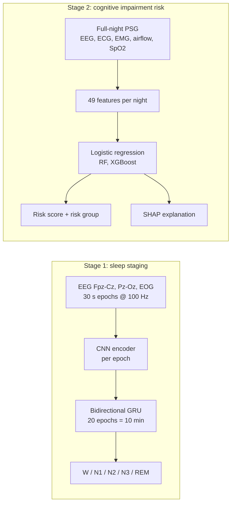
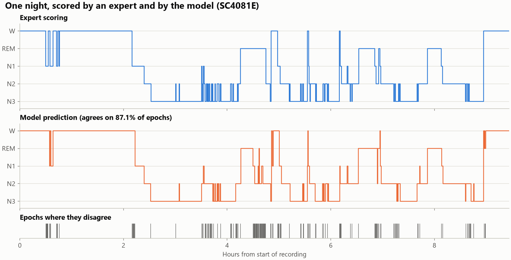
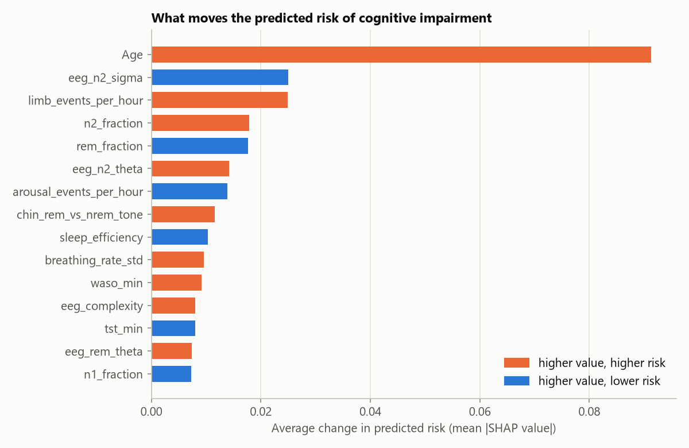

<div align="center">

# Sleep → Cognition

**AI-based prediction of cognitive impairment from one night of polysomnography**


[](LICENSE)

*Final-year engineering project*

</div>

---

Can an AI read one night's sleep recording and tell who is more likely to develop cognitive
impairment later, **beyond what age alone tells us**?

This project answers in two stages:

| | Stage | What it does | Data |
|---|---|---|---|
| **1** | **Sleep staging** | A neural network, trained from scratch, labels every 30 s of an overnight recording as W, N1, N2, N3 or REM | [Sleep-EDF Expanded](https://physionet.org/content/sleep-edfx/1.0.0/) |
| **2** | **Cognitive impairment risk** | 49 measurements per night (sleep structure, EEG, heart, breathing, oxygen, muscle tone) feed models that predict later impairment, explained with SHAP | [PhysioNet Challenge 2026](https://moody-challenge.physionet.org/2026/) (Human Sleep Project) |

## Contents

- [Highlights](#highlights)
- [How it works](#how-it-works)
- [Results](#results)
- [Datasets](#datasets)
- [Getting started](#getting-started)
- [Usage](#usage)
- [Project structure](#project-structure)
- [Limitations](#limitations)
- [Acknowledgements](#acknowledgements)
- [Citation](#citation)
- [License](#license)

## Highlights

- **82.4% sleep-stage accuracy** (Cohen's κ 0.767) on 20 recordings the network never saw.
- **Beats age alone** at predicting later cognitive impairment: age-conditioned AUROC **0.667** vs **0.531**, across **6,522 people** from **3 hospitals**.
- **Tested on unseen hospitals:** each hospital is held out of training in turn and used as the test set.
- **Explainable:** SHAP shows which sleep signals raise or lower each person's risk.
- **Scales to 1.2 TB:** feature extraction streams one night at a time, in parallel, with checkpoints.

## How it works



**Stage 1.** A 1-D CNN turns each 30-second epoch (3 channels) into a feature vector. A
bidirectional GRU then reads 20 consecutive epochs, so each prediction sees the 10 minutes
around it, the way a human scorer uses context.

**Stage 2.** Each night becomes 49 measurements: stage fractions and timing, EEG band power per
stage (including sleep-spindle sigma power), heart rate and variability, breathing, oxygen
saturation, limb movements and chin muscle tone. Models are compared against an **age-only**
baseline, because age alone already predicts impairment.

## Results

### Stage 1: sleep staging

| Metric (20 held-out recordings) | Score |
|---|---|
| Accuracy | **82.4%** |
| Macro F1 | **0.800** |
| Cohen's κ | **0.767** |

| Stage | W | N1 | N2 | N3 | REM |
|---|---|---|---|---|---|
| F1 | 0.901 | 0.579 | 0.840 | 0.802 | 0.877 |

<p align="center">
  
  
</p>

### Stage 2: cognitive impairment

6,522 people, 497 later impaired (7.6%).

| Age-conditioned AUROC | Age only | Logistic regression |
|---|---|---|
| 5-fold cross-validation × 10 | 0.531 | **0.667** |
| Held-out hospital I0002 (317 people) | 0.518 | **0.762** |
| Held-out hospital I0006 (1,133 people) | 0.533 | **0.690** |
| Held-out hospital S0001 (5,072 people) | 0.537 | **0.565** |

> **Why age-conditioned?** It only compares people within 2 years of age of each other, so it
> measures what sleep adds beyond age. 0.5 = guessing. Random forest and XGBoost were also
> tested; logistic regression was the most robust. Full numbers are in
> [`results/hsp_large_baseline_report.txt`](results/hsp_large_baseline_report.txt).

<p align="center">
  
</p>

The strongest sleep signals are **reduced sleep-spindle (sigma) power**, **more limb
movements**, **more light N2 sleep** and **less REM sleep**.

## Datasets

| Dataset | Used for | Contents | Access |
|---|---|---|---|
| [Sleep-EDF Database Expanded 1.0.0](https://physionet.org/content/sleep-edfx/1.0.0/) | Stage 1 | 197 overnight recordings from 100 people (Sleep Cassette, age 25–101, and Sleep Telemetry). EEG Fpz-Cz, EEG Pz-Oz and EOG at 100 Hz with expert hypnograms. 8.1 GB, open access | [Direct zip](https://physionet.org/static/published-projects/sleep-edfx/sleep-edf-database-expanded-1.0.0.zip) → unzip to `Dataset/archive/sleep-edf-database-expanded-1.0.0/` |
| [PhysioNet Challenge 2026](https://moody-challenge.physionet.org/2026/) (Human Sleep Project) | Stage 2 | Clinical PSG (EEG, EOG, chin and leg EMG, ECG, airflow, effort belts, SpO2) with CAISR sleep-stage annotations, demographics and later cognitive diagnosis. Large training set: 6,522 people, 3 hospitals, ~1.2 TB | From the Challenge page under its data terms; not republished here |

The raw recordings are not in this repository. Included are the trained network
`checkpoints/sleep_stager.pt` (7.7 MB) and the summary tables `data/features.csv` and
`data/sleep_edf/index.csv`.

## Getting started

```powershell
git clone https://github.com/Omkar123puri5678/AIagent.git
cd AIagent
python -m venv .venv
.\.venv\Scripts\Activate.ps1
pip install torch --index-url https://download.pytorch.org/whl/cu126
pip install -r requirements.txt
```

> Training runs in full precision: half precision (autocast) produces NaNs on GTX 16-series GPUs.

## Usage

### Stage 1: sleep staging

```powershell
python preprocess.py   # raw recordings -> labelled epochs in data/sleep_edf/
python train.py        # train, save the best model to checkpoints/
python evaluate.py     # score the saved model on the held-out test subjects
python plots.py        # result images in results/
python explore.py      # one recording: raw signals, filtering, spectrum, time-frequency
python features.py     # band-power and Hjorth features for every epoch
python baseline.py     # logistic regression baseline on those features
```

### Stage 2: cognitive impairment

The Challenge data is about 1.2 TB, so feature extraction streams it one night at a time
(parallel workers, checkpointed, optionally sharded) and keeps only a small table:

```powershell
python hsp_features.py <path to Challenge 2026 data> --out hsp_features.csv
```

Put `hsp_features.csv` and the dataset's `demographics.csv` in `data/hsp_large/`, then:

```powershell
python hsp_baseline.py data/hsp_large   # age only, logistic regression, random forest, XGBoost
python hsp_explain.py data/hsp_large    # SHAP explanations, risk groups, worked examples
```

### Score a new night

```powershell
python predict.py train data/hsp_large   # fit the final model, save checkpoints/cognitive_model.joblib
python predict.py night <recording.edf> <caisr_annotations.edf> --age 67 --sex female
python predict.py table data/hsp_large/hsp_features.csv <record> --age 67 --sex female
```

The output gives a risk score, the person's rank overall and among people of the same age, their
risk group, and the five features that moved the risk most. In cross-validation, 31.7% of the high
group were later impaired, against 3.0% of the low group.

## Project structure

```
├── config.py            Model size and training settings
├── preprocess.py        Filter, epoch, label and normalise Sleep-EDF recordings
├── dataset.py           Subject-wise train/val/test split and batching
├── model.py             CNN per epoch + bidirectional GRU across epochs
├── train.py             Training loop, early stopping, test report
├── evaluate.py          Accuracy, macro F1, Cohen's kappa, confusion matrix
├── plots.py             Result figures
├── explore.py           Step-by-step look at one raw recording
├── features.py          Hand-made epoch features (band power, Hjorth)
├── baseline.py          Logistic regression baseline for sleep staging
├── hsp_features.py      49 measurements per night from Challenge 2026 data
├── hsp_baseline.py      Impairment models, cross-validation, leave-one-hospital-out
├── hsp_explain.py       SHAP explanations and risk groups
├── predict.py           Save the final model and score a new night
├── demo.html            Results presentation
├── design.html          Block diagram, design flow and architecture
├── checkpoints/         Trained sleep-stage network
├── data/                Small summary tables
└── results/             Figures and reports
```

## Limitations

- **Research model, not a diagnosis.** It reflects patterns across many people and must not be
  used to make decisions about an individual's health.
- Performance varies by hospital (age-conditioned AUROC 0.565–0.762), so results may not
  transfer to new sites without checking.
- BMI is left out on purpose: whether it was recorded at all gave away the label.

## Acknowledgements

- [PhysioNet](https://physionet.org/) for Sleep-EDF Expanded and the George B. Moody PhysioNet
  Challenge 2026 data.
- Built with PyTorch, MNE, scikit-learn, XGBoost and SHAP.

## Citation

If you use this code, please cite it using [`CITATION.cff`](CITATION.cff) (GitHub's
**Cite this repository** button reads it).

## License

The code is released under the [MIT License](LICENSE). The datasets keep their own licences and
terms of use from PhysioNet and are not covered by it.
